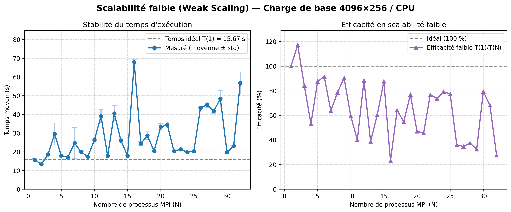
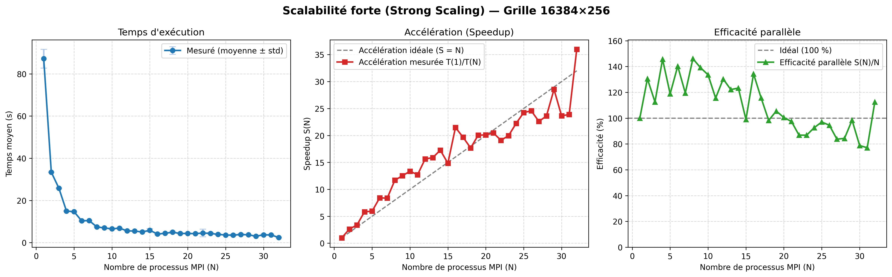

# 2D Time-Dependent Schrödinger Equation Solver (MPI / FFTW)

  

Project of quantum mechanics during **Master 2 Ams at Paris-Saclay**. 
We use the FFT from fftw librairy to solve the problem and the code is build for parallel computing architectures.

## Repository Structure

### 1. `Fentes de Young` (Young's Double-Slit Experiment)

The Fentes de Young folder is the Young experiment, since the problem isn't periodique we have to add an other potential and solve the non homogen problem and we had a source that repeat in time to simulate a laser.

  

### 2. `Particule_reseau_périodique` (Particle in a Crystal Lattice)
The Particule_reseau_périodique is the simulation of a crystal lattice in this case we have a good usage of the FFTW since cristalin lattice is periodic.

  

### 3. `Scalabilite` (HPC Benchmarks)

The Scalabilité folder is the crystal lattice simulation when we have remove the writting of the solution and it's juste pure calculation. We then proceed to run a weak and strong scalabily test.

  

  

