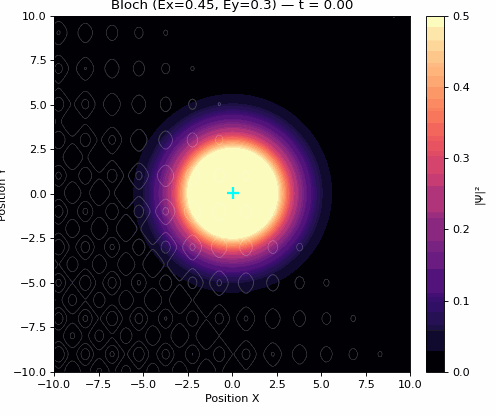
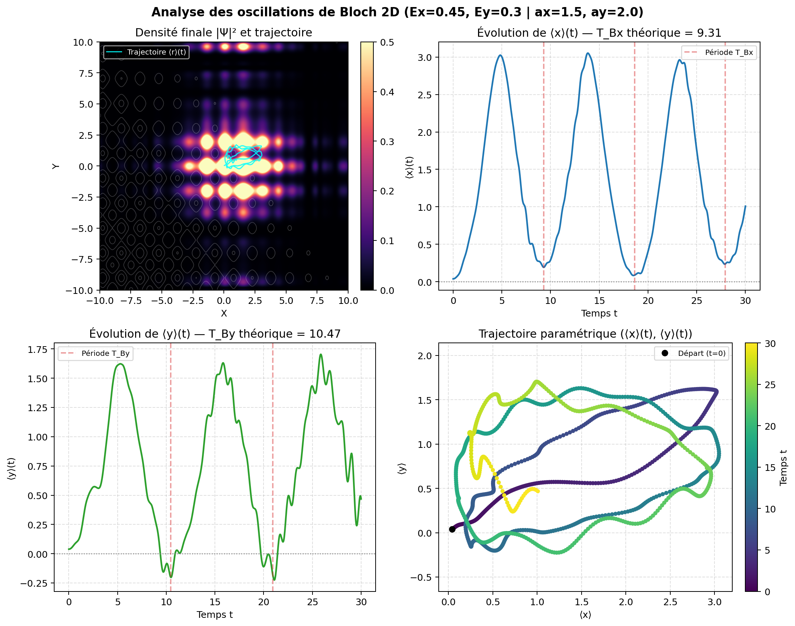
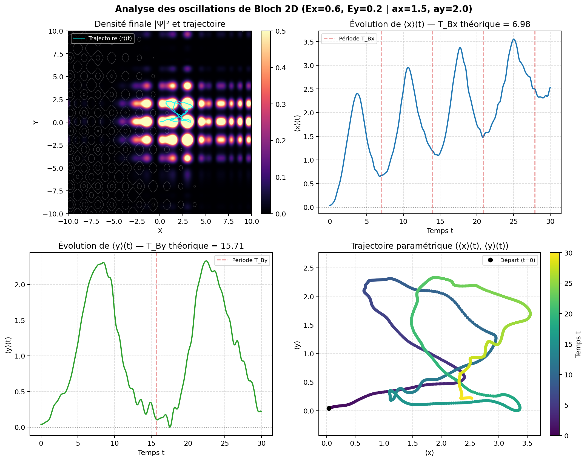
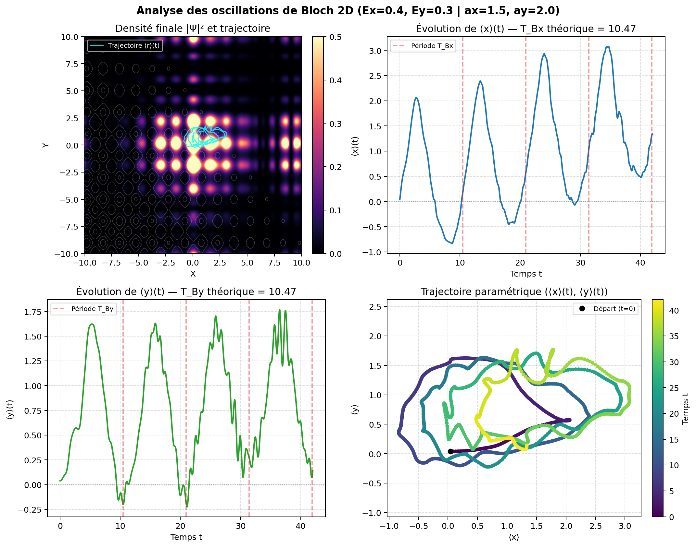
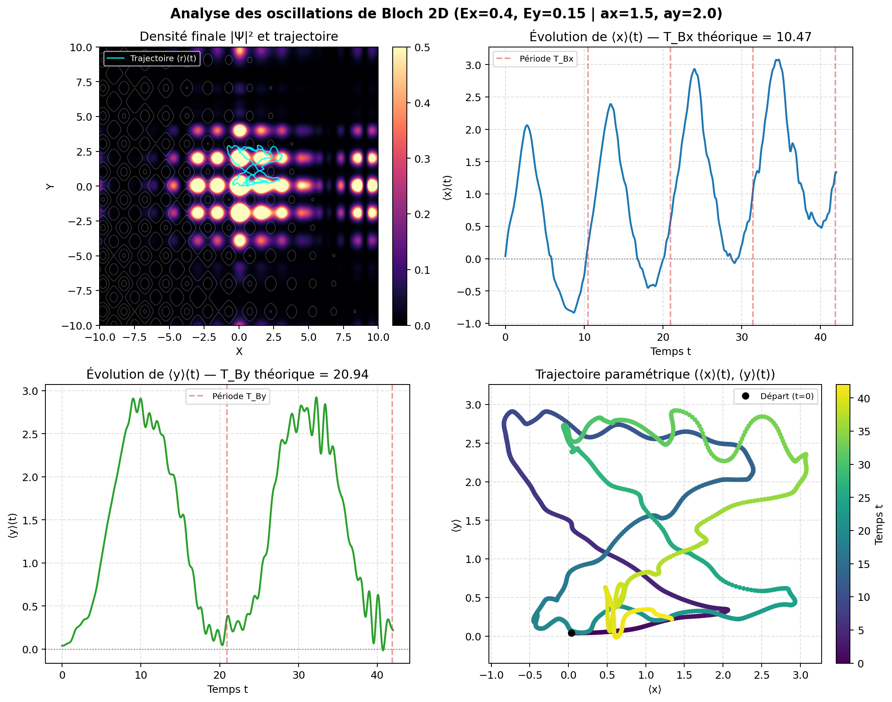
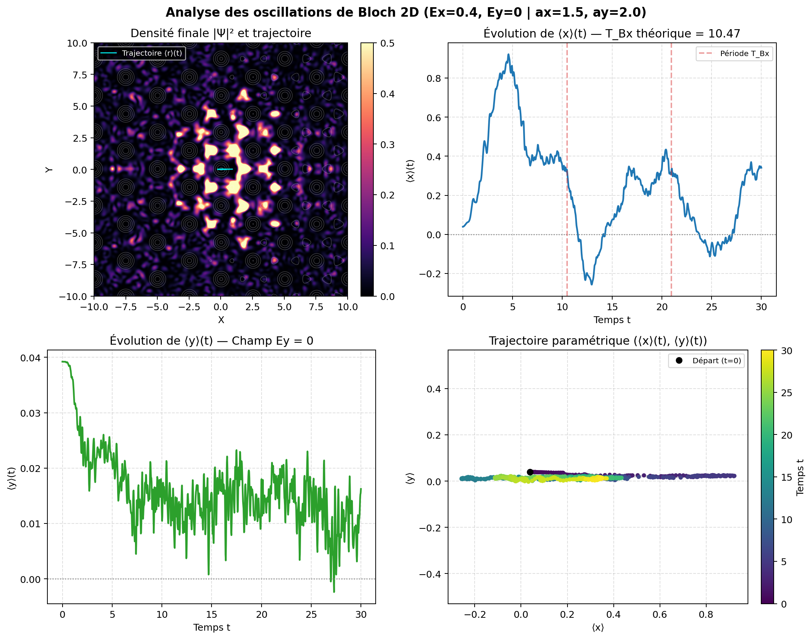
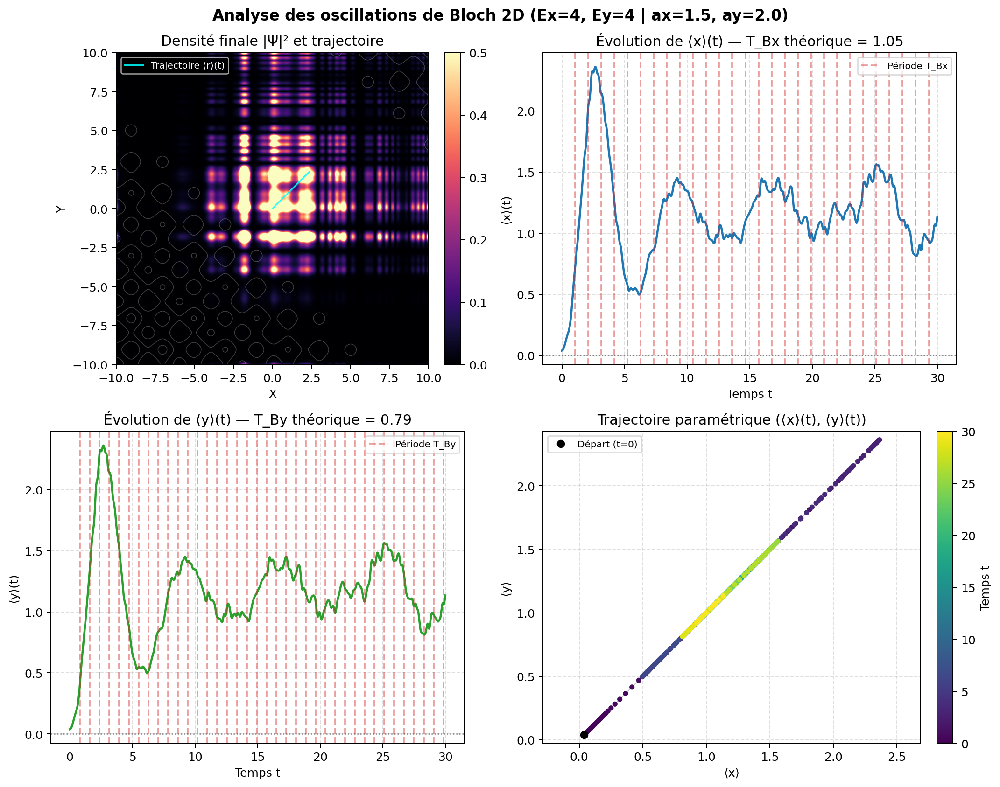
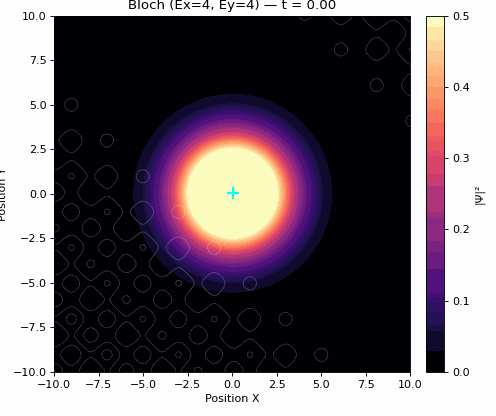
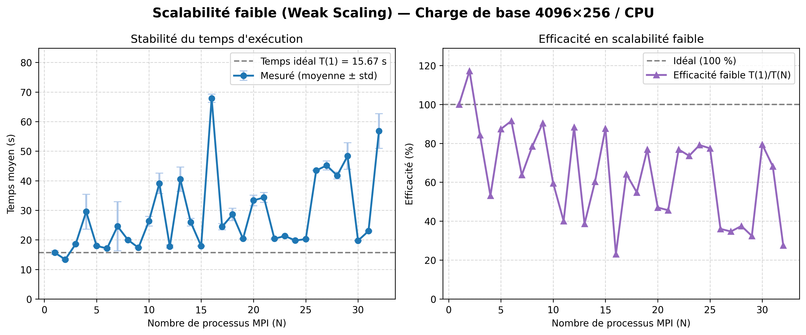

# 2D Time-Dependent Schrödinger Equation Solver (MPI / FFTW)

<p align="center">
  
</p>

Project of quantum mechanics during **Master 2 Ams at Paris-Saclay**. 
We use the FFT from fftw librairy to solve the problem and the code is build for parallel computing architectures.

---

## Quick Start

### Dependencies
* C++20 compiler (`g++` or `clang++`)
* **OpenMPI** & **FFTW3** (with MPI support enabled)
* **Python 3** (`numpy`, `matplotlib`, `pillow`) for post-processing and animations

* **macOS (Homebrew) :** `brew install open-mpi fftw python`
* **Ubuntu / Debian :** `sudo apt install g++ libopenmpi-dev libfftw3-dev python3-pip`

### Build & Run
```bash
# Compile with the provided Makefile
make

# Run in parallel on 4 MPI processes for exemple if not specified (no -np $`N`$ then it's on all cpu)
mpirun -np 4 ./a.out
```

## Repository Structure

### 1. `Fentes de Young` (Young's Double-Slit Experiment)

The Fentes de Young folder is the Young experiment, since the problem isn't periodique we have to add an other potential and solve the non homogen problem additionally we've added a source that repeat in time to simulate a laser.

<p align="center">
  
</p>

### 2. `Particule_reseau_périodique` (Particle in a Crystal Lattice)
The Particule_reseau_périodique is the simulation of a crystal lattice in this case we have a good usage of the FFTW since cristalin lattice is periodic.

<p align="center">
  
</p>

When a static uniform electric field $`\mathbf{E} = (E_x, E_y)`$  is applied across the periodic lattice, Bragg reflections prevent unbounded acceleration and induce periodic Bloch oscillations with theoretical period $`T_{B,i} = \frac{2\pi}{E_i a_i}`$.

We see the Bloch oscillations:

#### The idea

<p align="center">
  
</p>

We can take a look at the expectation value for $`x`$: $`\langle x \rangle_{\psi} = \iint x \lvert \psi(x, y) \rvert^2 \, dx \, dy`$, and doing the same for $`y`$, we can plot the trajectory $`(\langle x \rangle_{\psi}(t),\, \langle y \rangle_{\psi}(t))`$, that we see is circle-like.

<p align="center">
  
</p>

#### Other tests

For other value we get a Lissajous curve in 8-shape: (Both the previous one and this one are done with no initial speed)

<p align="center">
  
</p>

<p align="center">
  
</p>

#### Lissajous curve with initial speed for phase change

We now give $`k0x = \pi/(2.0\times a_x)`$ to get a $`\pi/2`$ phase change:

The circle like shape: 

<p align="center">
  
</p>


<p align="center">
  
</p>

The 8 shape:

<p align="center">
  
</p>


<p align="center">
  
</p>

#### More cools results, a hexagonal lattice

Extension to a non-separable 2D hexagonal (triangular) lattice potential,

<p align="center">
  
</p>

<p align="center">
  
</p>

#### Same size for lattice constante

<p align="center">
  
</p>

<p align="center">
  
</p>

### 3. `Scalabilite` (HPC Benchmarks)

The Scalabilité folder is the crystal lattice simulation where we have removed the writting part of the solution and it's juste pure calculation. We then proceed to run a weak and strong scalabily test.

<p align="center">
  
</p>
<p align="center">
  
</p>